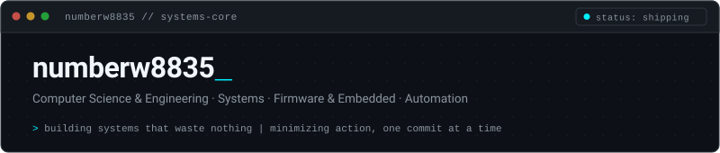

<picture>
  <source media="(prefers-color-scheme: dark)" srcset="https://raw.githubusercontent.com/numberw8835/numberw8835/main/assets/header-dark.svg" />
  <source media="(prefers-color-scheme: light)" srcset="https://raw.githubusercontent.com/numberw8835/numberw8835/main/assets/header-light.svg" />
  
</picture>

$$ \delta S = \delta \int \mathcal{L} \, dt = 0 \quad \cong \quad \min_{P} \mathcal{O}(M[P]) $$

> *"The universe computes by the principle of least action. We may never match the simulation, but our code should strive to approach it."*

---

### `$ whoami`

Computer Science & Engineering student and systems enthusiast focused on high-efficiency architectures, bare-metal firmware, and automation workflows. Driven by the principle of least action: zero unnecessary overhead, deterministic execution, and automating everything twice.

- 📍 **Focus:** Low-latency systems, edge AI & embedded hardware-software interfaces
- ⚡ **Current Endeavor:** Embodied AI edge inference (Llama 3.2 + Whisper) on bare-metal RP2040
- 🛠️ **Methodology:** Eliminate computational waste, automate repetitive pipelines

---

### Featured Systems & Projects

| Project | Description | Stack |
| :--- | :--- | :--- |
| **[Smart-home-AI-system](https://github.com/numberw8835/Smart-home-AI-system)** | Embodied AI smart home system bridging local LLMs (Llama 3.2) & Whisper with ESP8266 Wi-Fi and bare-metal RP2040 Pico C firmware via hardware flow control. | `C` `RP2040` `ESP8266` `Llama 3.2` `Whisper` |
| **[Octoback](https://github.com/numberw8835/Octoback)** | High-performance local file backup and tracking tool engineered for low overhead and deterministic archiving. | `Python` `Systems Tooling` `CLI` |
| **[stringen](https://github.com/numberw8835/stringen)** | Minimalist, zero-dependency C utility for high-throughput algorithmic string generation and security tooling. | `C` `Algorithms` `Low-Level` |
| **[Automation & Workflows](https://github.com/numberw8835)** | Autonomous event-driven pipelines orchestrating webhooks, system daemons, and micro-services. | `n8n` `Bash` `CI/CD` |

---

### Toolchain

  
  
  
  
  
  
  
  
  
  
  
  
  

---

### Activity

<picture>
  <source media="(prefers-color-scheme: dark)" srcset="https://raw.githubusercontent.com/numberw8835/numberw8835/output/snake-dark.svg" />
  <source media="(prefers-color-scheme: light)" srcset="https://raw.githubusercontent.com/numberw8835/numberw8835/output/snake.svg" />
  
</picture>

---

[GitHub](https://github.com/numberw8835) &nbsp;·&nbsp; [Email](mailto:numberw8835@gmail.com)

 

"Minimizing the action, one commit at a time."

